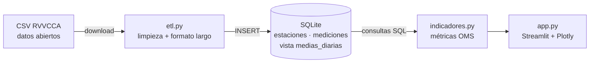

# 🌬️ Calidad del aire en València — dashboard interactivo

[](https://github.com/AdrianColomoMoragues/aire-valencia-dashboard/actions/workflows/ci.yml)

Dashboard web que analiza los datos horarios de la **Red Valenciana de Vigilancia y Control de la Contaminación Atmosférica (RVVCCA)** en la ciudad de València y los compara con las **guías de calidad del aire de la OMS (2021)**.

> 📸 *Añade aquí una captura o GIF del dashboard (`docs/dashboard.png`).*
> 🔗 *Demo: añade aquí el enlace de Streamlit Community Cloud cuando lo despliegues.*

## Qué hace

- **ETL reproducible**: descarga el CSV oficial, detecta el formato (separador, coma decimal, formatos de fecha y hora), limpia valores erróneos y lo pasa a formato largo. Corrige un error del CSV oficial, que intercambia día y mes en el 36 % de las filas, y lo valida con el día de la semana. Cada carga deja en el log qué se descarta y por qué.
- **Base de datos SQLite** con un esquema normalizado (`estaciones`, `mediciones`), índices y una **vista SQL** de medias diarias.
- **Dashboard en Streamlit + Plotly** con filtros por contaminante, estación y periodo:
  - KPIs: media, peor día y días por encima de la guía OMS.
  - Serie temporal diaria con media móvil y la línea de la guía OMS.
  - Comparativa entre estaciones.
  - Mapa de calor día de la semana × hora (se ven los picos de tráfico).
  - Tabla resumen descargable en CSV.
  - Interruptor para excluir los datos marcados por el control de calidad.
- **Control de calidad de sensores**: detecta valores atascados, picos aislados y derivas del O₃ respecto al resto de la red. Los datos se marcan sin borrarlos, y la regla de deriva encontró sola un fallo real del sensor de O₃ de Puerto Valencia en 2018.
- **Análisis del confinamiento de 2020** (página propia del dashboard): diferencia en diferencias frente a 2016–2019, comparación con la variación de un año normal y prueba placebo con 2021. Resultado: **el NO₂ bajó ~60 %** en el confinamiento; en partículas y O₃ el efecto no es concluyente.
- **Métricas correctas para cada contaminante**: media diaria para PM, NO₂ y SO₂, y máximo diario de la media móvil de 8 h para O₃, como define la OMS. Solo se cuentan días con al menos el 75 % de horas (criterio de la UE).
- **Tests con pytest** y **CI con GitHub Actions**.

## Stack

`Python` · `pandas` · `SQLite` · `SQL` · `Streamlit` · `Plotly` · `pytest` · `GitHub Actions`

## Arquitectura



## Cómo ejecutarlo

```bash
git clone https://github.com/AdrianColomoMoragues/aire-valencia-dashboard.git
cd aire-valencia-dashboard
python -m venv .venv && source .venv/bin/activate   # en Windows: .venv\Scripts\activate
pip install -r requirements.txt

# 1) Cargar los datos (elige una opción)
python -m aire.etl              # descarga el dataset oficial (~45 MB)
python -m aire.etl --sample     # datos sintéticos, sin internet

# 2) Lanzar el dashboard
streamlit run app.py
```

> Si pasas de datos sintéticos a reales, borra antes `data/aire.db`: la carga es `INSERT OR REPLACE` y las estaciones sintéticas no se eliminan solas.
>
> El informe técnico del proyecto está en [`Documentation.ipynb`](Documentation.ipynb) (`pip install -r requirements-dev.txt` para ejecutarlo).

Tests:

```bash
pytest -q
```

## Estructura

```
aire-valencia-dashboard/
├── aire/
│   ├── config.py        # URLs, contaminantes y guías OMS
│   ├── etl.py           # extract → transform → load (CLI)
│   ├── db.py            # esquema SQL y consultas
│   ├── indicadores.py   # métricas diarias, superaciones y escala de la guía
│   ├── calidad.py       # control de calidad de sensores
│   ├── confinamiento.py # efecto del confinamiento de 2020
│   └── sample.py        # generador de datos sintéticos
├── pages/1_Confinamiento_2020.py   # página del dashboard
├── tests/               # 32 tests (ETL, calidad, confinamiento)
├── Documentation.ipynb  # informe técnico
├── app.py               # dashboard Streamlit (página principal)
└── .github/workflows/ci.yml
```

## Datos

- **Fuente**: [Datos horarios de calidad del aire desde 2016](https://opendata.vlci.valencia.es/en/dataset/hourly-air-quality-data-since-2016), portal de datos abiertos del Ajuntament de València (RVVCCA, Generalitat Valenciana).
- **Licencia**: CC BY 4.0.
- Los datos **no se suben al repositorio**; se regeneran con el ETL.
- La opción `--sample` genera datos **sintéticos** con patrones realistas (horas punta, estacionalidad, episodios de polvo sahariano), pero los valores no son reales.

## Decisiones técnicas

- **Formato largo** (`estacion, fecha_hora, contaminante, valor`) en lugar de una columna por contaminante: añadir un contaminante nuevo no cambia el esquema, y las consultas se filtran con un simple `WHERE`.
- **`INSERT OR REPLACE` con clave primaria compuesta**: el ETL es idempotente, así que ejecutarlo dos veces no duplica datos.
- **Colores fijos por estación**: una estación conserva su color aunque cambien los filtros o el orden del ranking.

## Autor

**Adri** — Grado en Ciencia de Datos e Inteligencia Artificial, Universidad Miguel Hernández.
